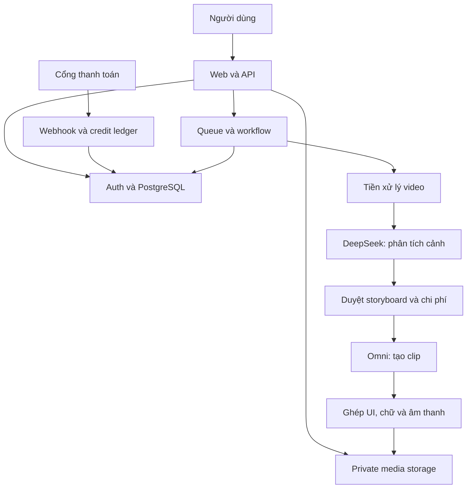

# SaaS Video Studio — Kế hoạch sản phẩm và triển khai
Bản 0.3 • Ngày 13/10/2026 (UTC+7) • Repo đã được cung cấp; bắt đầu nền tảng contracts/compiler offline. API trả phí và live billing chưa bật.
Các yêu cầu xác nhận tại mục 1 đã được chốt. Chi phí, công nghệ và lịch triển khai vẫn là đề xuất; đã được yêu cầu tiếp tục công việc; chưa được duyệt chi tiền.
Phạm vi công việc hiện tại: lập kế hoạch, chuẩn bị tài liệu repo; đã triển khai compiler offline cho end card; chưa triển khai SaaS hoàn chỉnh, chưa mua dịch vụ hoặc gọi API có phí.

## 1. Mục tiêu
Người dùng đưa video quảng bá SaaS tham chiếu, cung cấp sản phẩm/brand của họ, hệ thống phân tích cảnh và tài nguyên bằng DeepSeek rồi tạo video mới với Google Gemini Omni Flash. Có chỉnh sửa, quản lý dự án, đăng nhập, dữ liệu riêng, thanh toán, credit, xuất video và vận hành admin.

Giá trị cốt lõi: chuyển ngôn ngữ hình ảnh của video mẫu thành storyboard có thể chỉnh sửa và thành video phù hợp sản phẩm mới. Không hứa phục dựng chính xác file nguồn hay mọi layer từ một video đã ghép phẳng. Nhận diện tài nguyên, crop vùng thấy được và tái tạo là ba khả năng khác nhau; asset bị che không thể khôi phục chắc chắn.

### Phạm vi đã xác nhận
- Thị trường quốc tế, ưu tiên agency; bản đầu một tài khoản cá nhân, nhiều dự án/brand của khách hàng nhưng chưa có team seats.
- Bám sát nhịp, chuyển động và bố cục từng cảnh; lưu riêng các chi tiết thay được theo brand: màu, logo, font, chữ, CTA và tài nguyên.
- Đồng ý hybrid AI + renderer chính xác. Đầu ra MP4 và brand kit/tài nguyên đã cung cấp; không yêu cầu file After Effects.
- Video ngang 16:9, 1920×1080, dưới 60 giây. Đề xuất timeline export 30 fps theo prompt mẫu; cần duyệt khác biệt với clip AI 24 fps.
- Voiceover, nhạc nền, SFX, phụ đề và LUFS chuyển P1.
- Subscription tháng kèm credit; Stripe và PayPal là hai tích hợp được yêu cầu, live phụ thuộc điều kiện merchant.
- Chưa có API keys; cần phương án tiết kiệm và ngân sách thử nghiệm trước khi mua dịch vụ.
- Repo public SaaS-Make-SaaS-Explain đã được chủ dự án tạo và cung cấp; không cần đăng nhập trình duyệt.

### Giả định vẫn cần xác nhận
- Một video mẫu upload/dự án; đầu vào đề xuất tối đa 3 phút/250 MB, chưa chốt.
- Giao diện và prompt biên dịch tiếng Anh. Chỉ dùng tài nguyên người dùng có quyền sử dụng.
- AI keys thuộc hệ thống; BYOK để sau. Không có generation miễn phí không giới hạn.
- Retention tiết kiệm đề xuất: nguồn 7 ngày, clip nháp 7 ngày, output 30 ngày; giữ brand kit khi tài khoản còn hoạt động. Trước purge cần thông báo và policy được duyệt.
- “Tách tài nguyên” P0 là nhận diện + mapping + dùng tài nguyên brand; tự phục dựng mọi asset nguồn là ngoài P0, chờ xác nhận mục 6.

## 2. Kết quả xác minh API
Tài liệu chính thức được kiểm tra trong phiên lập kế hoạch; vẫn cần smoke test với tài khoản thật trước chốt.

| Thành phần | Kết quả xác minh | Cách dùng trong dự án |
|---|---|---|
| DeepSeek | Tài liệu Vision mô tả deepseek-flash nhận ảnh và văn bản; không dùng điều này để kết luận nhận MP4 trực tiếp | Tách keyframe có timestamp, thêm transcript, phân tích chuỗi ảnh; lưu confidence |
| Google | Gemini Omni Flash là model tạo/chỉnh video; model ID tài liệu: gemini-omni-1.1-flash, Interactions API | Adapter tạo từng clip, lưu interaction ID và capability theo model |
| Giới hạn Omni | Tài liệu nêu giới hạn riêng cho video upload dùng edit/extend, khác với video hiểu nội dung; YouTube không phải media source được hỗ trợ trong hướng dẫn Omni | Validation theo operation; chia cảnh trước, không gửi cả phim dài tùy ý |
| Chất lượng SaaS | Tính chính xác chữ/UI cần đo trên mẫu thật | Đề xuất renderer riêng cho chữ/logo/screenshot; AI lo hình ảnh/chuyển động phù hợp |
| Supabase | Auth tích hợp PostgreSQL và RLS; Storage có kiểm soát truy cập | Một lựa chọn cho auth, DB và private storage; chưa provision |
| Render | Remotion hỗ trợ video bằng React; license thương mại cần kiểm tra cho sản phẩm tạo video | Không mặc định miễn phí; benchmark cùng phương án renderer khác |
| Thanh toán | Webhook là thành phần cần xử lý an toàn, chống sự kiện trùng | Chưa chọn merchant; chốt theo quốc gia/pháp nhân và payout |

Nguồn:
- https://api-docs.deepseek.com/guides/vision/
- https://api-docs.deepseek.com/api/list-models/
- https://ai.google.dev/gemini-api/docs/video
- https://ai.google.dev/gemini-api/docs/omni
- https://ai.google.dev/gemini-api/docs/models/gemini-omni-flash
- https://ai.google.dev/gemini-api/docs/pricing
- https://supabase.com/docs/guides/auth
- https://supabase.com/docs/guides/storage/security/access-control
- https://docs.stripe.com/webhooks
- https://www.remotion.dev/docs/the-fundamentals
- https://www.remotion.dev/license

## 3. Luồng người dùng
1. Đăng ký → xác thực → workspace.
2. Tạo dự án → upload video mẫu → nhập tên/mục tiêu/ngôn ngữ.
3. Upload brand kit, logo, screenshot giao diện và tài nguyên riêng.
4. Hệ thống kiểm tra file → cắt cảnh → keyframe/transcript → DeepSeek phân tích.
5. Người dùng xem từng cảnh: nội dung, bố cục, chữ, chuyển động, chuyển cảnh, danh mục tài nguyên.
6. Map tài nguyên mẫu sang tài nguyên riêng; thêm asset còn thiếu.
7. AI viết thông điệp mới, storyboard và prompt; người dùng chỉnh và duyệt.
8. Xem dự toán credit → tạo một cảnh thử → duyệt → tạo các cảnh còn lại.
9. Sửa hoặc tạo lại riêng cảnh; giữ lịch sử version.
10. Dựng chữ/logo/UI, ghép cảnh, âm thanh, captions nếu bật → xem preview.
11. Export → tải video; xem chi phí, lịch sử, mua thêm credit hoặc quản lý gói.

### Những màn hình cần có
Landing, pricing, login/signup, verify/reset, onboarding, dashboard, create project wizard, upload manager, analysis review, brand library, storyboard editor, scene detail/history, generation progress, preview/export, billing/credit history, profile/settings, help, admin users/jobs/costs/configuration.
Mỗi màn hình cần có loading/empty/error/unauthorized và đường khôi phục thích hợp.

## 4. Kiến trúc đề xuất
Web và API nghiệp vụ: Next.js/TypeScript (đề xuất, phiên bản sẽ chốt khi scaffold).
Auth/DB: Supabase Auth + PostgreSQL/RLS; Free cho thử nội bộ, Pro đề xuất khi thu tiền.
Media: Cloudflare R2 private (đề xuất tiết kiệm băng thông); quyền truy cập do server kiểm tra trước cấp signed URL. RLS của Supabase không tự bảo vệ R2.
Media worker: container xử lý FFmpeg, scene detection, keyframes, render; không giữ một HTTP request trình duyệt mở suốt quá trình.
Queue P0: jobs/outbox trong PostgreSQL, worker lease + heartbeat, một media job đồng thời. Chưa mua Redis hay workflow service riêng; benchmark và kiểm thử crash/retry trước dùng production.
AI: adapter riêng DeepSeek và Google; model ID, rate card và capability version hóa.
Render P0: template SVG/Canvas hoặc HTML có cấu trúc + FFmpeg; tránh phí license renderer khi chưa cần editor nâng cao. Đánh giá công sức tự xây và license dependencies; Remotion chỉ là phương án thay thế sau so sánh tổng chi phí.
Payment: adapter Stripe + PayPal, ledger dùng chung; mỗi workspace tối đa một subscription trả tiền đang hoạt động, không tự chuyển recurring mandate giữa hai cổng.
Hosting tiết kiệm: web/API và media worker là container riêng trên một VPS, giới hạn RAM/CPU worker để bảo vệ web. Vercel Pro là lựa chọn vận hành tiện hơn, chưa chọn mặc định. Không dùng Vercel Hobby cho SaaS thương mại.



### Phân biệt ba dạng dựng
- AI video: tạo clip có hình ảnh/chuyển động; phù hợp nền, chuyển động trừu tượng, cảnh minh họa.
- UI motion chính xác: dùng asset thật, layout và thông số animation có cấu trúc.
- Hybrid (đề xuất): kết hợp hai dạng trên. Độ trung thành với cảnh mẫu phải được chấm, không cam kết “giống 100%”.

Không cho mô hình sinh mã rồi chạy trực tiếp trên worker. Renderer chỉ nhận schema và template/component cho phép.

## 5. Mô hình dữ liệu dự kiến
| Nhóm | Bảng chính | Ràng buộc trọng yếu |
|---|---|---|
| Identity | profiles, workspaces, memberships | unique(workspace_id,user_id), role; ID user gắn hệ auth |
| Project | projects, project_versions, brand_kits | workspace_id bắt buộc; version không ghi đè bản đã render |
| Source/media | assets, asset_derivatives, asset_licenses | object key nội bộ, checksum, mime, duration, retention, provenance |
| Phân tích | analyses, source_scenes, analysis_evidence | timestamp, model/prompt version, confidence; evidence tham chiếu asset |
| Storyboard | storyboards, scenes, scene_versions, scene_asset_bindings | thứ tự và thời lượng hợp lệ; approved_snapshot bất biến |
| AI | generations, generation_attempts, provider_requests | idempotency key; status, interaction ID, actual usage |
| Media export | compositions, renders, exports | manifest hash; version scene/asset chính xác |
| Jobs | jobs, job_steps, job_events, outbox_events | lease/heartbeat, attempt, unique dedupe key |
| Billing | billing_customers, subscriptions, invoices, payments, webhook_events | unique(provider,event_id), provider status và kỳ billing |
| Credit | credit_grants, credit_reservations, credit_ledger, usage_events | integer units; immutable postings; unique logical operation |
| Vận hành | notifications, support_tickets, audit_logs, model_configs, rate_cards | least privilege; cấu hình/giá có hiệu lực từ ngày |

DB chỉ chứa metadata; video nằm ở object storage. Mọi query người dùng phải kiểm tra workspace ở server và RLS. Service-role chỉ chạy server và phải giới hạn query theo tenant rõ ràng.
Không lưu thông tin thẻ thanh toán. Dữ liệu tài chính giữ theo policy đã được xác nhận.

### Scene contract
Một scene cần: scene_id, source_start/end, output_duration, evidence_frames, observed_text, inferred_layout, assets[], motion[], transition_in/out, audio_cues[], confidence, unresolved_items[].
Phiên bản scene mới bổ sung: brand_text, asset_bindings, render_mode, prompt_version, generation_settings, continuity_dependencies, approved_by, approved_at.
Phân biệt dữ liệu nhìn thấy và suy đoán. Font/easing/camera mô tả gần đúng khi không thể đo chính xác.

### API nghiệp vụ dự kiến
- POST /projects; GET/PATCH/DELETE /projects/:id.
- POST /uploads/sign; POST /uploads/:id/complete.
- POST /projects/:id/analyze; GET /analyses/:id.
- GET/PATCH /storyboards/:id; POST /storyboards/:id/approve.
- POST /quotes; POST /generations (approved snapshot + quote_id + idempotency key).
- POST /scenes/:id/regenerate; GET /jobs/:id; POST /jobs/:id/cancel.
- POST /renders; GET /exports/:id/download.
- POST /billing/checkout; POST /billing/portal; POST /webhooks/payments.
- Admin routes tách quyền; không tin workspace_id hoặc số credit do client gửi.

## 6. Trạng thái, sửa cảnh và khôi phục
Luồng chính: DRAFT → UPLOADING → PREPROCESSING → ANALYZING → REVIEW_REQUIRED → QUOTED → QUEUED → GENERATING → RENDERING → READY.
FAILED/PARTIAL/CANCEL_REQUESTED/CANCELLED là nhánh có xử lý riêng.
Khi sửa storyboard: tăng version, vô hiệu quote cũ, đánh dấu scene output lỗi thời; job đang chạy vẫn gắn snapshot cũ.
Khi phụ thuộc frame cuối cảnh trước: chỉ tạo sau khi cảnh trước đã được duyệt; sửa cảnh trước yêu cầu kiểm tra lại cảnh sau. Không tạo lại toàn bộ mặc định.
Khi request timeout sau khi gửi provider: trạng thái UNKNOWN/PENDING_RECONCILIATION; tra provider nếu có, không gửi lại mù quáng.
Người dùng đóng tab không dừng job. Worker crash phải khôi phục từ checkpoint.
Hủy không đảm bảo hoàn tác phí đã phát sinh ở nhà cung cấp; UI phải nói rõ trước.

## 7. Thanh toán và kinh tế sản phẩm
Đề xuất subscription kèm credit và mua thêm credit; giá bán chưa chốt.
Một credit là đơn vị nội bộ nguyên; tỷ lệ USD/credit, hết hạn và chuyển kỳ là quyết định kinh doanh.
Phân biệt hóa đơn thật, credit người dùng và chi phí nhà cung cấp.
- Quote: tính dự toán theo snapshot, thời hạn và rate-card version.
- Reserve: giữ credit trong transaction có khóa/constraint để hai job không tiêu cùng số dư.
- Consume: ghi chi phí theo chính sách khi bước hoàn tất.
- Release: trả phần chưa dùng.
- Refund/adjustment: bút toán bù; không sửa/xóa lịch sử.
- Không cấp credit chỉ vì browser quay về success URL.
- Webhook xác thực, dedupe, xử lý đảo thứ tự và đối soát định kỳ.
- Lỗi do hệ thống, khách đổi ý và AI không đạt thẩm mỹ cần policy khác nhau; phải chốt trước thu tiền.

### Ước tính biến phí minh họa
Trang giá Google được kiểm tra nêu khoảng 0,10 USD/giây output 720p Omni Standard, chưa gồm input/thinking và các dịch vụ khác. Đây là tham chiếu lập kế hoạch, không phải giá bán hay báo giá cố định.
| Thời lượng AI xuất thực tế | Một lượt | Trung bình hai lượt cho cùng lượng cảnh |
|---|---:|---:|
| 15 giây | khoảng 1,50 USD | khoảng 3 USD |
| 30 giây | khoảng 3 USD | khoảng 6 USD |
| 60 giây | khoảng 6 USD | khoảng 12 USD |

Tính theo tổng giây tạo có tính phí, không chỉ độ dài file giao cuối. Crop clip 10 giây còn 4 giây không làm chi phí tự giảm còn 4 giây. Regenerate, extension, nhiều phiên bản và upscale phải đo riêng.
C_total = analysis + generated_video + image_assets + voice/music + render_compute + storage/egress + failed_attempts + payment_fees + support_allocation.
Margin = (doanh thu thuần sau hoàn tiền và phí - giá vốn phân bổ) / doanh thu thuần theo định nghĩa thống nhất.
100 video hoàn tất, mỗi video 30 giây AI và trung bình hai lượt tạo: chỉ phần video output tham chiếu đã khoảng 600 USD; chưa phải toàn bộ chi phí tháng.
Chưa chốt ngân sách hạ tầng tối thiểu vì cần concurrency, retention, license renderer và ngân sách thử nghiệm. Dùng bảng báo giá nhà cung cấp tại thời điểm phê duyệt; không hứa production miễn phí.

## 8. Quy tắc backlog và nghiệm thu
120 task: 112 task nền tảng thuộc 14 epic, thêm 8 task E15 đặc thù brand/template ở cuối tài liệu. E05-07 và E10-04..06 chuyển P1; E10-08 share link tùy chọn để P1. E14-06..08 vẫn là khảo sát P1. Phạm vi v0.2 ưu tiên hơn mô tả cũ nếu có khác biệt.
Quy mô S=1: khoảng 0,5–1 ngày kỹ thuật; M=2: 1–2 ngày; L=3: 2–4 ngày. Đây là ước lượng thô từng đầu việc, chưa gồm chờ review/vendor. Không cộng máy móc thành cam kết lịch.
Đầu việc L phải được tách tiếp thành các PR nhỏ sau khi chốt giải pháp.
Dependencies trong mỗi epic: mặc định theo trình tự khi có đầu ra phụ thuộc; các phần độc lập chỉ làm song song khi contract đã chốt.
Trạng thái ban đầu: PLANNED; cập nhật hiện tại xem docs/implementation-status.md. Hoàn thành tài liệu không có nghĩa task triển khai đã xong.
Definition of done: đầu ra được review, đáp ứng tiêu chí hàng tương ứng, kiểm thử rủi ro liên quan, không lộ secret, cập nhật tài liệu vận hành nếu có.

### E01 — Chốt sản phẩm và kiểm chứng AI
Ưu tiên: P0. Vai trò phụ trách dự kiến: PM + AI. Phụ thuộc epic: —.

| ID | Task | Đầu ra cụ thể | Tiêu chí hoàn tất | Quy mô |
|---|---|---|---|---|
| E01-01 | Thu thập bộ mẫu | 10 video có quyền sử dụng; phân nhóm UI, typography, 3D, mixed | Có mục tiêu và mức chất lượng mong muốn cho từng mẫu | M |
| E01-02 | Xác minh tài khoản API | Kiểm tra model, vùng, quota, billing; chạy thử sau khi được duyệt ngân sách | Lưu model ID và kết quả thực tế, không chỉ tài liệu | M |
| E01-03 | Chuẩn hóa bài benchmark | Thang điểm ranh giới cảnh, chữ, chuyển động, brand, thời gian, chi phí | Cùng một rubric cho mọi lần thử; có người chấm | M |
| E01-04 | Thử DeepSeek đọc keyframe | So sánh lấy mẫu thưa/dày, frame đầu/giữa/cuối | Đo bỏ sót cảnh nhanh và OCR; có confidence | L |
| E01-05 | Thử Omni theo cảnh | So sánh text, ảnh tham chiếu, continuity và sửa cảnh | Có ít nhất 3 video mẫu đầu ra để chủ dự án duyệt | L |
| E01-06 | Thử lớp chữ và UI chính xác | Ghép chữ/logo/ảnh sản phẩm độc lập với nền AI | Tên sản phẩm và CTA không bị model tự đổi | L |
| E01-07 | Đo unit economics | Log token, giây tạo, số lần thử, render, lưu trữ | Tính chi phí trên một video đạt chất lượng, không chỉ lần gọi | M |
| E01-08 | Ra quyết định go/no-go | ADR về model, workflow, giới hạn, ngân sách | Chủ dự án duyệt kết quả trước khi làm toàn bộ SaaS | S |

### E02 — UX và thiết kế sản phẩm
Ưu tiên: P0. Vai trò phụ trách dự kiến: UX + PM. Phụ thuộc epic: E01.

| ID | Task | Đầu ra cụ thể | Tiêu chí hoàn tất | Quy mô |
|---|---|---|---|---|
| E02-01 | Sơ đồ hành trình | Từ đăng ký đến xuất video và mua thêm credit | Có nhánh thiếu tài nguyên, lỗi AI và hết credit | S |
| E02-02 | Sitemap và wireframe | Landing, dashboard, wizard, editor, billing, settings, admin | Mỗi màn có hành động chính và điều kiện vào/ra | M |
| E02-03 | Design tokens | Màu, type, spacing, radius, theme, trạng thái | Dùng một bộ biến có quy tắc tương phản | M |
| E02-04 | Component kit | Button, form, modal, upload, scene card, player, job status | Đủ hover/focus/disabled/loading/error | L |
| E02-05 | Wizard tạo dự án | Mẫu video → brand → phân tích → storyboard → báo giá | Lưu nháp; đóng tab rồi mở lại vẫn tiếp tục được | M |
| E02-06 | Editor storyboard | Danh sách cảnh, preview, thuộc tính, asset mapping | Thao tác chỉnh cảnh không làm mất dữ liệu chưa lưu | L |
| E02-07 | Responsive và accessibility | Bàn phím, nhãn input, lỗi form, dashboard mobile | Luồng chính dùng được bằng bàn phím; editor ưu tiên desktop | M |
| E02-08 | Prototype và review | Prototype có tình huống mua credit và tạo lại cảnh | Chủ dự án duyệt UX và scope trước khi code UI | M |

### E03 — Nền tảng dự án và môi trường
Ưu tiên: P0. Vai trò phụ trách dự kiến: Full-stack + DevOps. Phụ thuộc epic: E01.

| ID | Task | Đầu ra cụ thể | Tiêu chí hoàn tất | Quy mô |
|---|---|---|---|---|
| E03-01 | DONE — Lưu dự án vào repo đã được cung cấp | TUANPG2772/SaaS-Make-SaaS-Explain (public); README và docs | Có URL thật, owner đúng, không chứa key | S |
| E03-02 | Quy ước phát triển | Branch, PR template, issue template, definition of done | Task ID gắn được với PR và release | S |
| E03-03 | Scaffold web và worker | Monorepo web, worker, shared schemas, renderer | Web và worker khởi động riêng với health check | M |
| E03-04 | Chất lượng mã | Typecheck, lint, format và test framework | CI chặn build khi lỗi type hoặc kiểm thử quan trọng | S |
| E03-05 | Ba môi trường | Local, staging, production; tách DB và khóa | Staging không dùng dữ liệu hay khóa thanh toán live | M |
| E03-06 | Quản lý cấu hình | Env schema, secret manager, xoay khóa | Không có secret trong bundle, git hoặc log | S |
| E03-07 | CI/CD | Preview PR, migration check, build và deploy theo môi trường | Có artifact version và quy trình rollback | M |
| E03-08 | Theo dõi vận hành | Structured logs, correlation ID, error tracker | Truy từ project đến job và provider request mà không lộ nội dung riêng | M |

### E04 — Đăng nhập, workspace và database
Ưu tiên: P0. Vai trò phụ trách dự kiến: Backend. Phụ thuộc epic: E03.

| ID | Task | Đầu ra cụ thể | Tiêu chí hoàn tất | Quy mô |
|---|---|---|---|---|
| E04-01 | Thiết kế schema/migration | Bảng tenant, dự án, cảnh, asset, jobs, billing; ERD | FK, index, unique constraint và migrate staging thành công | L |
| E04-02 | Đăng ký và đăng nhập | Email/password hoặc magic link; Google OAuth theo quyết định | Đăng nhập, đăng xuất, hết phiên và callback hoạt động | M |
| E04-03 | Xác thực/khôi phục tài khoản | Verify email, quên mật khẩu, đổi email, rate limit | Token hết hạn và link dùng lại bị từ chối | M |
| E04-04 | Workspace cá nhân | Tạo workspace mặc định; vai trò owner/editor/viewer | Không tự nâng role; một user không xem tenant khác | M |
| E04-05 | Phân quyền DB và storage | RLS, server authorization, signed download | Test user A không đọc/sửa/xóa asset và job của B | L |
| E04-06 | Profile và cài đặt | Tên, avatar, ngôn ngữ, timezone, thông báo | Validate và lưu được; không cho đổi trường hệ thống | S |
| E04-07 | Lifecycle dữ liệu | Xóa dự án/tài khoản, soft-delete, purge, giữ chứng từ cần thiết | Xóa bao gồm file/phụ bản/provider theo policy; có trạng thái hoàn tất | M |
| E04-08 | Backup và khôi phục | Backup DB, manifest storage, diễn tập restore | Khôi phục staging thành công; ghi RPO/RTO đã đo | M |

### E05 — Upload và tiền xử lý video
Ưu tiên: P0. Vai trò phụ trách dự kiến: Media + Backend. Phụ thuộc epic: E04.

| ID | Task | Đầu ra cụ thể | Tiêu chí hoàn tất | Quy mô |
|---|---|---|---|---|
| E05-01 | Upload trực tiếp có tiếp tục | Signed upload, progress, quota và phiên tải | Mạng ngắt có thể tiếp tục; file dở được dọn | L |
| E05-02 | Kiểm tra file phía server | Magic bytes, codec, duration, kích thước, pixel budget | Đổi đuôi file không vượt kiểm tra; có lỗi dễ hiểu | M |
| E05-03 | Lưu nguồn an toàn | Private bucket, checksum, metadata và retention | Asset luôn có workspace_id; URL tải có hạn | S |
| E05-04 | Tạo proxy và thumbnail | Chuẩn hóa xoay ảnh, fps/timebase, audio stream | Preview đúng chiều và audio/video không lệch | L |
| E05-05 | Phát hiện cảnh | Hard cut, fade và transition; cho sửa mốc thủ công | So với bộ mẫu; không tạo cảnh âm hoặc overlap ngoài chủ ý | L |
| E05-06 | Trích keyframe thích nghi | Đầu/giữa/cuối và frame bổ sung lúc chuyển động nhanh | Giữ timestamp, crop đầy đủ; giới hạn tổng ảnh và chi phí | M |
| E05-07 | P1 — Tách âm thanh và transcript | Speech-to-text adapter, đoạn lời và timecode nếu bật voice | Video im lặng vẫn đi tiếp; ngôn ngữ/độ tin cậy được lưu | M |
| E05-08 | Hủy và dọn xử lý | Cancel trước/sau từng bước, sandbox media, TTL file tạm | Worker crash không để rác vô hạn; file lỗi không chạy shell tùy ý | M |

### E06 — Phân tích DeepSeek và tài nguyên
Ưu tiên: P0. Vai trò phụ trách dự kiến: AI + Backend. Phụ thuộc epic: E05.

| ID | Task | Đầu ra cụ thể | Tiêu chí hoàn tất | Quy mô |
|---|---|---|---|---|
| E06-01 | Adapter DeepSeek | Request ảnh + văn bản, timeout, usage, model version | Contract test schema; 429/5xx được phân loại | M |
| E06-02 | Schema phân tích cảnh | Timeline, layout, text, palette, camera, motion, transition | JSON hợp lệ; tọa độ normalized và mốc giây nhất quán | M |
| E06-03 | Asset inventory | Mô tả logo, icon, nền, UI, font gần đúng, audio cue | Tách observed/inferred/unknown; không nhận đoán font là chắc chắn | M |
| E06-04 | OCR và đối chiếu | Nhận headline, CTA, chữ UI và mức tin cậy | Chữ không đọc được đánh dấu cần sửa; không tự bịa | M |
| E06-05 | Mô tả chuyển động | So sánh chuỗi frame; quỹ đạo, tốc độ, easing ước tính | Nêu giới hạn suy luận giữa frame; có nguồn timestamp | L |
| E06-06 | Tổng hợp style bible | Nhịp, palette, typography, motif và nguyên tắc chuyển cảnh | Có style xuyên cảnh; không giữ tên/brand mẫu ngoài chủ ý | M |
| E06-07 | Validate và sửa đầu ra | Schema validation, một vòng repair có trần; fallback thủ công | JSON sai không đi vào generation; trả lỗi có thể xử lý | M |
| E06-08 | Màn hình duyệt phân tích | Video và scene report cạnh nhau; sửa split/merge | Lưu phiên bản; phân tích lại không ghi đè bản người dùng đã duyệt | L |

### E07 — Brand kit và storyboard mới
Ưu tiên: P0. Vai trò phụ trách dự kiến: Full-stack + AI. Phụ thuộc epic: E06.

| ID | Task | Đầu ra cụ thể | Tiêu chí hoàn tất | Quy mô |
|---|---|---|---|---|
| E07-01 | Brand kit | Logo, màu, font có quyền dùng, screenshots, tên và CTA | Có preview và kiểm tra font/ảnh thiếu | M |
| E07-02 | Brief sản phẩm | Đối tượng, lợi ích, tính năng, tone, ngôn ngữ, thời lượng | Thông tin chưa có được hỏi hoặc để placeholder rõ ràng | S |
| E07-03 | Map tài nguyên | Mỗi asset tham chiếu được thay bằng asset brand/generate/rebuild | Mọi tài nguyên bắt buộc có nguồn và quyền dùng | M |
| E07-04 | Tạo script mới | Thông điệp và cấu trúc theo sản phẩm của khách | Không sao chép lời hay claim sản phẩm từ video mẫu | M |
| E07-05 | Đặt thời lượng cảnh | Phân bổ theo script; split theo giới hạn model | Tổng thời lượng khớp target trong sai số được duyệt | M |
| E07-06 | Chỉnh storyboard | Sửa text, reorder, thêm/xóa/duplicate scene, undo | Thay đổi tạo version mới và đánh dấu output cũ là stale | L |
| E07-07 | Tạo keyframe bố cục | Preview bằng asset thật và template hoặc image model tùy chọn | Duyệt trước khi render tốn tiền; font và CTA rõ | L |
| E07-08 | Khóa storyboard + báo giá | Snapshot scenes/assets/prompt; quote có hạn sử dụng | Sửa bản đã duyệt bắt buộc tính lại giá cho phần thay đổi | M |

### E08 — Điều phối jobs và chi phí
Ưu tiên: P0. Vai trò phụ trách dự kiến: Backend. Phụ thuộc epic: E03, E04, E07.

| ID | Task | Đầu ra cụ thể | Tiêu chí hoàn tất | Quy mô |
|---|---|---|---|---|
| E08-01 | State machine | DRAFT→ANALYZING→REVIEW→QUEUED→GENERATING→RENDERING→READY | Có failed/partial/cancelled; chuyển trạng thái được kiểm soát | M |
| E08-02 | Queue bền vững | Job lease, heartbeat, concurrency theo workspace và provider | Worker chết có thể tiếp tục, không chạy song song cùng attempt | L |
| E08-03 | Idempotency/outbox | Request key + DB transaction + outbox | Click hai lần chỉ tạo một logical job và một hold credit | L |
| E08-04 | Retry có kiểm soát | Backoff+jitter, max attempts, budget cap, dead letter | Không retry payment/model rejection hoặc timeout chưa rõ một cách mù quáng | M |
| E08-05 | Provider reconciliation | Lưu request/interaction ID; tra cứu trạng thái trước gửi lại | Timeout chưa rõ giữ pending; không charge hoặc generate trùng | L |
| E08-06 | Tiến độ và thông báo | Polling/SSE, bước hiện tại, email khi xong tùy chọn | Refresh/trở lại vẫn đúng; không hiển thị phần trăm giả chính xác | M |
| E08-07 | Hủy và tạo lại riêng cảnh | Dừng bước chưa gửi; đánh dấu kết quả đến muộn | Cảnh đạt được tái dùng; chi phí đã phát sinh được hiển thị | M |
| E08-08 | Đối soát và giới hạn ngân sách | Usage journal, spend cap hệ thống/tenant, cảnh báo và kill switch | Vượt trần chặn gọi mới; daily reconciliation phát hiện lệch | L |

### E09 — Tạo và chỉnh video bằng Omni
Ưu tiên: P0. Vai trò phụ trách dự kiến: AI + Media. Phụ thuộc epic: E01, E07, E08.

| ID | Task | Đầu ra cụ thể | Tiêu chí hoàn tất | Quy mô |
|---|---|---|---|---|
| E09-01 | Adapter Omni | Model ID cấu hình, Interactions API, media delivery | Lưu usage, provider ID, output metadata; capability check | M |
| E09-02 | Biên dịch prompt từng cảnh | Brand + layout + motion + duration + assets | Prompt có version/hash; không đưa khóa hay dữ liệu tenant khác | M |
| E09-03 | Sinh clip thử trước | Tạo một cảnh đại diện với chi phí đã báo | Người dùng duyệt hoặc sửa trước khi tạo hàng loạt | M |
| E09-04 | Tạo các cảnh còn lại | Lên lịch theo quota; scene độc lập có thể song song | Giữ thứ tự ghép dù hoàn tất khác thứ tự | L |
| E09-05 | Liên tục giữa cảnh | Style bible, anchor frame và dependency nếu dùng frame trước | Regenerate cảnh trước đánh dấu cảnh phụ thuộc để review | L |
| E09-06 | Sửa cảnh bằng ngôn ngữ | Prompt chỉnh sửa và previous interaction khi được hỗ trợ | Giữ lịch sử, quote mới; không hứa giữ mọi pixel | L |
| E09-07 | Lưu output độc lập | Tải output provider vào storage riêng; checksum và TTL | Link provider hết hạn vẫn tải được bản đã lưu | M |
| E09-08 | QA clip và fallback | Black frame, decode, duration, brand/text review | Clip lỗi được chặn hoặc gắn cờ; người dùng có thể upload thay | L |

### E10 — Dựng phim, âm thanh và xuất bản
Ưu tiên: P0. Vai trò phụ trách dự kiến: Media + Frontend. Phụ thuộc epic: E09.

| ID | Task | Đầu ra cụ thể | Tiêu chí hoàn tất | Quy mô |
|---|---|---|---|---|
| E10-01 | Renderer có cấu trúc | Template allowlist, ảnh/logo/text layers, không chạy code AI tự do | Chữ và logo render đúng từ dữ liệu đã duyệt | L |
| E10-02 | Timeline và ghép cảnh | Trim, fit, padding, transition; fps/timebase thống nhất | Không có đoạn đen/gap ngoài chủ ý và duration đúng | L |
| E10-03 | Editor cơ bản | Preview, chọn version, trim, reorder, sửa overlay | Preview và export dùng chung manifest | L |
| E10-04 | P1 — Nhạc nền có quyền dùng | Upload/thư viện có license, chọn đoạn, fade in/out | Lưu nguồn/license; không mặc định lấy nhạc video tham chiếu | M |
| E10-05 | P1 — Voiceover tùy chọn | Upload giọng hoặc TTS adapter sau khi chốt nhà cung cấp | Timing phù hợp script; giọng/lời có preview duyệt | M |
| E10-06 | P1 — Mix âm lượng | Voice ducking, LUFS target, true peak (P1); P0 chỉ loại bỏ audio clip AI khi export không âm thanh | Không clipping; thông số đầu ra đo bằng công cụ | M |
| E10-07 | Export | MP4 1920×1080, 16:9, dưới 60 giây; poster và nhãn AI upscale; dự kiến 30 fps | Phân biệt độ phân giải AI gốc và upscale; file play được | L |
| E10-08 | Download và lịch sử | Signed URL, export version, manifest, optional share link | Quyền download được kiểm tra; link chia sẻ có thu hồi | M |

### E11 — Thanh toán, gói và credit
Ưu tiên: P0. Vai trò phụ trách dự kiến: Backend + PM. Phụ thuộc epic: E01, E04, E08.

| ID | Task | Đầu ra cụ thể | Tiêu chí hoàn tất | Quy mô |
|---|---|---|---|---|
| E11-01 | Chọn cổng thanh toán | Stripe + PayPal: kiểm tra pháp nhân/quốc gia, payout, phí, subscription | Tài khoản merchant đủ điều kiện; không mặc định Stripe dùng được | M |
| E11-02 | Định nghĩa gói | Subscription tháng + credit; expiry, rollover, mua thêm và giới hạn | Có bảng chính sách minh bạch trước checkout | M |
| E11-03 | Checkout và portal | Hosted checkout, mua thêm, lịch sử, hủy gia hạn | UI thành công không tự cấp credit khi chưa có webhook xác thực | M |
| E11-04 | Webhook đáng tin cậy | Verify signature, event dedupe, out-of-order, retry | Replay sự kiện không cấp thêm credit; lưu inbox | L |
| E11-05 | Credit ledger bất biến | Grant/reserve/consume/release/refund/expire bằng integer | Atomic balance và constraint; concurrent jobs không âm số dư | L |
| E11-06 | Lifecycle subscription | Gia hạn, past_due, cancel, upgrade/downgrade, proration | Quyền dùng theo kỳ đã trả; các event đảo thứ tự vẫn đúng | L |
| E11-07 | Hoàn tiền và tranh chấp | Refund/chargeback, admin adjustment có lý do | Không xóa ledger; có bút toán bù và đối soát provider | M |
| E11-08 | Kiểm thử sandbox thanh toán | 3DS nếu có, fail, duplicate, refund, renewal, cancel | Bộ tình huống chạy pass trước bật live | L |

### E12 — Admin, hỗ trợ và vận hành sản phẩm
Ưu tiên: P0. Vai trò phụ trách dự kiến: Full-stack. Phụ thuộc epic: E08, E11.

| ID | Task | Đầu ra cụ thể | Tiêu chí hoàn tất | Quy mô |
|---|---|---|---|---|
| E12-01 | Admin RBAC và MFA | Vai trò support/finance/admin và log truy cập | User thường không vào admin; thao tác nhạy cảm có audit | M |
| E12-02 | Quản lý user/workspace | Tìm kiếm, trạng thái, quota và khóa truy cập có lý do | Không tự ý xem video riêng; truy cập hỗ trợ được giới hạn | M |
| E12-03 | Bảng jobs | Queue, provider, retry, cancel, replay an toàn | Không có nút retry bỏ qua spend cap hoặc credit guard | M |
| E12-04 | Bảng doanh thu/chi phí | Gross/net revenue, refund, AI cost, margin, storage | Định nghĩa metric rõ; đối chiếu ledger và invoice | M |
| E12-05 | Cấu hình runtime | Model, rate card, plan, feature flag, maintenance | Version hóa; thay đổi giá không sửa quote/job cũ | M |
| E12-06 | Hỗ trợ trong app | Ticket, liên hệ, job ID và hướng dẫn tự xử lý | Không đính kèm secret/nội dung riêng ngoài sự đồng ý | S |
| E12-07 | Email giao dịch | Verify, receipt theo provider, hoàn tất job, failed payment | Có template và preference phù hợp; tránh gửi trùng | M |
| E12-08 | Phân tích funnel | Signup→upload→approve→render→purchase | Có opt-out phù hợp; không log raw video/prompt vào analytics | S |

### E13 — Bảo mật, chất lượng và điều kiện ra mắt
Ưu tiên: P0. Vai trò phụ trách dự kiến: QA + Security + DevOps. Phụ thuộc epic: E04–E12.

| ID | Task | Đầu ra cụ thể | Tiêu chí hoàn tất | Quy mô |
|---|---|---|---|---|
| E13-01 | Threat model | Tenant leak, malicious media, prompt injection, SSRF, billing abuse | Mỗi rủi ro có guard, owner và cách kiểm chứng | M |
| E13-02 | Harden upload và URL | Decoder sandbox, resource cap, SVG sanitization; URL allowlist nếu bật | Private network/metadata endpoints không thể fetch qua URL khách | M |
| E13-03 | Bảo vệ ứng dụng | CSP, session/cookie, CSRF, rate limit, dependency scan | Không còn lỗi nghiêm trọng chưa được xử lý trước beta | M |
| E13-04 | Test nghiệp vụ quan trọng | Tenant isolation, ledger race, webhook replay, crash recovery | Regression bảo vệ luồng tiền và dữ liệu; có fixtures | L |
| E13-05 | E2E toàn hành trình | Signup→pay sandbox→upload→edit→generate→export | Có đường thật gọi API trong ngân sách và đường mock cho CI | L |
| E13-06 | Load và failure tests | Queue backlog, 429, timeout, storage outage, provider outage | Không mất job, double charge hoặc vượt concurrency; đo p95 | L |
| E13-07 | Chính sách và quyền sử dụng | Terms, privacy, retention, refund, provider data handling, license dependencies | Thông tin đúng cấu hình; phần pháp lý cần người có chuyên môn duyệt | M |
| E13-08 | Release checklist | Backup restore, alert routing, rollback, runbooks, cost kill switch | Diễn tập sự cố thành công; chủ dự án ký duyệt ra beta | M |

### E14 — Beta, launch và mở rộng
Ưu tiên: P0/P1. Vai trò phụ trách dự kiến: PM + Engineering. Phụ thuộc epic: E13.

| ID | Task | Đầu ra cụ thể | Tiêu chí hoàn tất | Quy mô |
|---|---|---|---|---|
| E14-01 | Private beta | Mời 5–10 người đúng nhóm, giới hạn tổng spend | Có feedback theo từng project và ghi cost thực tế | M |
| E14-02 | Đánh giá chất lượng | Tỷ lệ storyboard duyệt, cảnh cần làm lại, thời gian tới export | So với baseline; có danh sách lỗi ưu tiên theo tác động | M |
| E14-03 | Hiệu chỉnh giá bán | Tính chi phí median/p90, hỗ trợ, phí cổng, refund reserve | Không bán unlimited generation; margin theo giả định được duyệt | M |
| E14-04 | Production launch | Domain, email, live billing, limits, support | Chủ dự án duyệt; smoke test thanh toán/export và rollback sẵn | M |
| E14-05 | Lặp cải tiến | Theo dõi activation, paid conversion, retention, gross margin | Có roadmap theo dữ liệu, không chỉ số đăng ký | S |
| E14-06 | Team và agency — P1 | Invite, seat billing, khách hàng/brand riêng, approval | Chốt role/seat/credit ownership trước triển khai | L |
| E14-07 | Advanced editor — P1 | Nhiều track, keyframe, nhiều version/tỷ lệ và template marketplace | Ước lượng lại riêng; không coi là editor đầy đủ trong P0 | L |
| E14-08 | API và tích hợp — P1 | API public, webhook khách hàng, URL import, BYOK, automation | Thiết kế quota/auth/security riêng trước mở rộng | L |

## 9. Thứ tự thực hiện và các cổng duyệt
| Mốc | Phạm vi | Điều kiện chuyển bước |
|---|---|---|
| G0 — Chốt yêu cầu | Câu hỏi chủ dự án, mẫu video, ngân sách, repo | Có phạm vi P0 và quyền truy cập cần thiết |
| G1 — Chứng minh đầu ra | E01 | Chủ dự án duyệt 3 video thử, chất lượng và chi phí thật |
| G2 — Nền tảng và thiết kế | E02–E04 | UX, auth, tenant isolation, migrations đạt |
| G3 — Luồng tạo video | E05–E10 | Một hành trình từ upload đến export và sửa cảnh chạy thật |
| G4 — SaaS thu tiền | E11–E12 | Payment sandbox, ledger, admin và limits đạt |
| G5 — Private beta | E13, E14-01..03 | Security, E2E, crash/replay tests và cost cap đạt |
| G6 — Launch | E14-04..05 | Chủ dự án duyệt live billing/deploy và phương án support |

Đường găng: xác minh chất lượng → phân tích → storyboard → orchestration → generation → render → test toàn luồng.
Billing có thể phát triển sau khi chốt unit economics và ledger contract, không cần chờ mọi UI hoàn thiện.
Khung lịch sơ bộ cho nhóm 2–3 kỹ sư cùng UX/QA bán thời gian: khoảng 12–20 tuần đến beta nếu scope P0 giữ nguyên. Đây là khoảng lập kế hoạch, không phải cam kết; cập nhật sau G1 và E02. Một người thực hiện cần lịch dài hơn. Không mặc định tốc độ viết mã AI loại bỏ thời gian tích hợp, review và kiểm chứng sản phẩm.

### Tiêu chí beta đề xuất, cần chủ dự án xác nhận
- Chữ/logo/CTA ở lớp render: đúng nội dung đã duyệt, không sai chính tả; review thủ công mẫu chuẩn.
- Bộ benchmark 10 mẫu: ít nhất 8 đầu ra được chủ dự án chấm đạt; ghi số lần regenerate và tổng chi phí.
- Cảnh tự động: đo precision/recall với nhãn tay; ngưỡng và sai số mốc cảnh chốt sau baseline.
- Luồng chuẩn: ít nhất 95% job trong tập beta hoàn tất kỹ thuật không cần admin sửa, ngoài lỗi provider được ghi riêng.
- Không có tenant leak, double credit grant, overspend do race hoặc double provider submission trong test đã thiết kế.
- p50/p95 thời gian tạo, tỷ lệ retry và chi phí/video được đo; chưa hứa SLA số phút khi chưa benchmark.
- Không mở live nếu có lỗi nghiêm trọng về tiền, quyền truy cập hoặc mất dữ liệu.

## 10. Rủi ro và phương án
| Rủi ro | Tác động | Xử lý và điểm dừng |
|---|---|---|
| Output không giống nhịp/bố cục mong muốn | Mất giá trị cốt lõi | G1 benchmark; không xây hết billing rồi mới kiểm chứng |
| Chữ/UI/brand sai | Video không dùng thương mại được | Asset thật + compositor; review trước xuất |
| Không trích được asset gốc | Kỳ vọng sai | UI phân biệt detect/crop/rebuild; cho upload thay |
| Chi phí regenerate cao | Bán càng nhiều càng lỗ | Trial giới hạn, quote, credit reserve, spend cap, giá theo dữ liệu |
| Provider đổi model/giới hạn | Pipeline hỏng | Capability registry, contract tests, model version, fallback có duyệt |
| Webhook/worker chạy lặp | Cấp credit hoặc tạo video trùng | Dedupe, outbox, leases, reconciliation |
| Video chứa dữ liệu nhạy cảm | Rò rỉ khách hàng | Private storage, signed URLs, retention, dùng demo data, hạn chế log |
| Thiếu quyền với nhạc/asset mẫu | Không thể dùng đầu ra như kỳ vọng | Asset provenance, tài nguyên riêng, license và xử lý khiếu nại |
| License renderer/cổng payment không phù hợp | Chi phí hoặc launch bị chặn | Kiểm tra trước chọn, giữ interface để thay |
| Scope editor quá rộng | Trễ tiến độ | P0 editor theo cảnh; multi-track chuyên sâu là P1 |

## 11. Cấu trúc repo dự kiến
Repo: TUANPG2772/SaaS-Make-SaaS-Explain, public, do chủ dự án cung cấp. Cấu trúc dưới đây là mục tiêu, xem README để biết phần đã có.
- README.md — mục tiêu, trạng thái planning, navigation.
- docs/00-product-brief.md — phạm vi, persona, nguyên tắc.
- docs/01-prd.md — yêu cầu và user stories.
- docs/02-architecture.md — sơ đồ, runtime và threat model.
- docs/03-data-model.md — ERD, bảng, isolation, retention.
- docs/04-ai-pipeline.md — analysis schema, prompt, generation/QA.
- docs/05-billing-credits.md — quote, ledger, policies và event matrix.
- docs/06-backlog.md — 120 task, sau chốt chuyển thành issues.
- docs/07-milestones.md — dependencies, gates, estimates.
- docs/08-open-questions.md — câu hỏi/decision log.
- docs/09-cost-model.md — assumptions, rate card, benchmark thực tế.
- docs/adr/ — quyết định có ngày, người duyệt và phương án bị loại.
- .github/ISSUE_TEMPLATE/ — task, bug, decision.
- apps/web/, apps/worker/, packages/contracts/, packages/render/ — chỉ scaffold sau được duyệt xây dựng.

### Trạng thái GitHub thực tế
Repo người dùng cung cấp: https://github.com/TUANPG2772/SaaS-Make-SaaS-Explain
Repo public; dùng GitHub plugin để lưu tài liệu/mã nguồn. Không đưa secret hoặc dữ liệu khách hàng vào repository.
Phần nền tảng offline đã có: scene contract, validator, prompt compiler end card, ví dụ dữ liệu giả và kiểm thử. Chưa có giao diện SaaS, renderer MP4, auth, database thực, payment integration hoặc API provider.

## 12. Những điểm còn mở
1. Quốc gia đăng ký merchant, cá nhân hay công ty; đã có Stripe/PayPal Business đủ điều kiện nhận subscription chưa? “Bản cá nhân” của sản phẩm không trả lời câu hỏi pháp nhân nhận tiền.
2. Gửi video mẫu thực tế (prompt cảnh 12 đã có nhưng chưa có clip/ảnh cuối cảnh 11) để đo độ bám sát.
3. Chốt trần thử nghiệm 30 USD (đề xuất, chưa được phép chi) và mức hạ tầng beta; chưa cần chọn gói bán cuối cùng.
4. Có đồng ý P0 chỉ nhận diện/mapping tài nguyên, dùng logo/font/ảnh brand khách tải lên; tách nền và phục dựng asset nguồn tự động để P1?
5. Chấp nhận 1080p hybrid với footage AI upscale và lớp chữ/UI native 1080p, timeline 30 fps; không cam kết AI native 1080p/30 fps?
6. Retention nguồn/nháp 7 ngày, output 30 ngày và đầu vào tối đa 3 phút/250 MB có phù hợp không?

Các yêu cầu đã trả lời không cần hỏi lại. Tên repo, thị trường, định dạng, account cá nhân, subscription tháng và trì hoãn âm thanh đã được ghi nhận.

## 13. Quy trình làm tiếp sau khi có câu trả lời
Cập nhật decision log → chốt PRD/backlog → đưa tài liệu lên repo → tạo epic/issues theo task ID → chủ dự án duyệt G0 và ngân sách PoC → thực hiện G1 → chủ dự án duyệt chất lượng → triển khai các mốc tiếp.
Không tự kích hoạt thanh toán live, mua dịch vụ hoặc triển khai toàn bộ khi chủ dự án mới yêu cầu lập kế hoạch.


## 14. Đặc tả tái sử dụng cảnh và thay brand
Nguồn tham chiếu: file người dùng cung cấp Pasted markdown(3).md — cảnh 12, end card Megane.ai, 2,2 giây. Đây là prompt tham khảo, chưa phải bằng chứng hình ảnh về video gốc. Không khẳng định đã xem Doks.ai hoặc frame cuối cảnh 11.

### 14.1. Ba lớp dữ liệu bắt buộc
1. Scene Blueprint: loại cảnh, layout, camera, timeline, transition, continuity, style. Có ID/version và bằng chứng frame/timecode.
2. Brand Bindings: logo, màu, font, chữ, CTA, screenshots; có khóa biến toàn dự án và override từng cảnh.
3. Render Manifest: snapshot đã duyệt của hai lớp trên, asset hashes, model settings, clip IDs và hiệu ứng. Mỗi export truy ngược được manifest.

Không chỉ lưu một đoạn prompt dài. Prompt tiếng Anh là đầu ra biên dịch từ ba lớp; UI sửa biến, không yêu cầu người dùng tìm/thay tên brand thủ công trong hàng nghìn chữ.

| Biến thay được | Kiểu dữ liệu | Quy tắc khi đổi |
|---|---|---|
| brand.name | string | Chính xác spelling/case; không tự thêm domain |
| brand.logo | asset ID + intrinsic ratio | Giữ vùng chứa logo; bảo toàn tỷ lệ, không kéo méo |
| brand.primary/background/accent/textMuted | color tokens | Re-render layer liên quan; nền AI có thể phải regenerate |
| brand.font.heading/body | font asset + weight | Cần font có quyền dùng; kiểm tra thiếu glyph và text overflow |
| scene.headline/body/cta | string | Giữ layout envelope; fit theo giới hạn font size, quá dài yêu cầu sửa |
| scene.productScreenshot | asset ID | Crop/contain có preview; không tự bịa nội dung sản phẩm |
| scene.decorativeSymbol | asset/template ID | Dùng vector/asset, không dựa vào glyph ngôi sao tùy font |
| scene.timing | frame intervals | Được sửa có chủ đích; mặc định giữ nhịp mẫu |
| scene.lockedConstraints | rules | Không cho brand swap tự thay camera/timeline/layout đã khóa |

Agency một người vẫn cần nhiều brand kit, đặt tên khách hàng, duplicate project rồi chọn brand mới. Chưa cần mời thành viên/team billing.

### 14.2. Ví dụ cấu trúc cảnh 12 (đặc tả, chưa phải mã triển khai)
```json
{
  "schema_version": "0.2",
  "scene_id": "scene_12",
  "kind": "end_card",
  "canvas": {"width": 1920, "height": 1080, "fps": 30},
  "duration_frames": 66,
  "render_mode": "compositor",
  "bindings": {
    "logo": "brand.logo",
    "wordmark": "brand.name",
    "primary": "brand.primary",
    "background": "brand.background",
    "cta_font": "brand.font.body",
    "cta_color": "brand.textMuted",
    "cta_text": "scene.cta"
  },
  "editable_paths": ["bindings", "scene.cta"],
  "locked": ["camera", "logo_transform", "timeline", "layout"],
  "continuity": {
    "source_scene": "scene_11",
    "source_version": "REQUIRED_APPROVED_VERSION",
    "source_frame": "last_composited_frame",
    "inherit_layers": ["logo", "background", "halo"],
    "missing_source_action": "block_or_request_user_approved_keyframe"
  },
  "layout": {
    "logo": {"transform": "inherit_previous_scene"},
    "cta": {"align": "center_below_logo", "gap_px": 36, "font_size_px": 26},
    "sparkle": {"position": "left_of_cta", "height_px": 12}
  },
  "timeline": [
    {"start_frame": 0, "end_frame_exclusive": 3, "action": "inherit_hold"},
    {"start_frame": 3, "end_frame_exclusive": 9, "action": "cta_fade_slide", "opacity": [0,1], "y_offset_px": [6,0], "easing": "ease_out"},
    {"start_frame": 9, "end_frame_exclusive": 60, "action": "hold"},
    {"start_frame": 60, "end_frame_exclusive": 66, "action": "stable_final_hold"}
  ],
  "exit": "none_end_video",
  "audio": "none",
  "quality_checks": ["exact_brand_text", "exact_cta", "no_logo_transform_change", "no_fade_out", "frame_count_66"]
}
```
Các số 36px, 26px, 12px, 6px là lựa chọn nằm trong khoảng prompt mẫu, chưa đo từ video. Renderer quy định easing bằng hàm/curve cụ thể trong version để kết quả lặp lại được. CTA reveal dùng khoảng frame [3,9), trạng thái fully visible từ frame 9; không nhập timeline giây và frame mâu thuẫn.

### 14.3. Pattern prompt đầu ra
Mỗi cảnh đều có các mục này; compiler tự bỏ phần không áp dụng nhưng không bỏ continuity hoặc exact text checks:

```text
SCENE {{scene.number}} — {{scene.title}}
BRAND: {{brand.name}}
PRODUCT CONTEXT: {{brand.product_description}}

VIDEO FORMAT
Canvas {{canvas.width}}x{{canvas.height}}, {{canvas.aspect_ratio}}.
Final timeline: {{canvas.fps}} fps, {{scene.duration_frames}} frames.
Target scene duration: {{scene.duration_seconds}} seconds.
Provider output settings are defined separately from final export settings.

REFERENCE AND PURPOSE
Reference interval: {{scene.reference_interval}}.
Preserve the approved pacing, relative layout and motion: {{scene.reference_rules}}.
Scene purpose: {{scene.purpose}}.

CONTINUITY CONTRACT
Start from {{scene.previous_approved_frame}} when available.
Preserve: {{scene.inherit_elements}}.
Do not reconstruct locked elements: {{scene.locked_elements}}.
If the continuity input is missing, stop preparation and request it.

BRAND REPLACEMENTS
Logo asset: {{brand.logo_asset}}.
Colors: {{brand.color_tokens}}.
Typography assets and weights: {{brand.fonts}}.
Exact visible text: {{scene.text_items}}.
Product screenshots: {{scene.product_assets}}.

LAYOUT AND VISUAL HIERARCHY
{{scene.elements_with_positions_sizes_spacing_and_z_order}}
Respect the approved layout envelope for longer replacement text/logos.

TIMELINE
{{scene.timecoded_actions_and_holds}}

MOTION AND CAMERA
{{scene.motion_paths_easing_amplitude}}
{{scene.camera_rules}}

BACKGROUND AND LIGHTING
{{scene.background_description}}
{{scene.lighting_limits}}

FINAL FRAME AND NEXT SCENE
{{scene.final_frame_composition}}
{{scene.exit_or_continuation_rules}}

EXACT TEXT AND ASSET RULES
{{scene.verbatim_text_and_asset_requirements}}

FORBIDDEN CHANGES
{{scene.negative_constraints}}

RENDER OWNERSHIP
AI-generated layers: {{scene.ai_layers}}.
Composited layers: {{scene.precise_layers}}.
Do not bake composited text/logo into the AI background.
Audio: none for v1.

VALIDATION SUMMARY
{{scene.acceptance_checks}}
```
Không gửi placeholder chưa resolve cho provider. Compiler báo thiếu logo/font/continuity rõ ràng. Trong chế độ hybrid, master prompt mô tả cả cảnh nhưng AI subprompt chỉ mô tả lớp AI; compositor manifest sở hữu chữ/logo/timing chính xác để tránh chữ lặp hai lần.

### 14.4. Cách dựng tiết kiệm cảnh mẫu
Cảnh 12 chủ yếu là hold + CTA fade/slide, vì vậy ưu tiên dựng thuần compositor từ layer hoặc frame đã duyệt của cảnh 11, không gọi Omni mới. Nếu chỉ có ảnh phẳng đã chứa logo cũ, không thể đổi brand an toàn chỉ bằng thay biến; cần nền sạch/layer tách hoặc tái dựng và duyệt trước.
Logo/background/halo được kế thừa từ phiên bản cảnh 11 sau brand swap. Đổi brand ở cảnh 12 đơn lẻ khi các layer này đang khóa sẽ bị chặn hoặc yêu cầu cập nhật từ cảnh 11. Không chèn logo mới đè lên logo cũ rồi coi là hoàn tất.
Đối với cảnh phức tạp cần Omni: giữ style/layout targets, tạo AI clip rồi compositor đặt chữ/logo riêng. Camera di chuyển phức tạp có thể cần tracking/plane transform; nếu template không hỗ trợ thì chuyển review, không hứa mọi cảnh khớp pixel.

### 14.5. Chất lượng và độ phân giải
Tài liệu model hiện ghi 3–10 giây/clip ở 24 fps; tài liệu Omni mô tả 1080p/4K dùng upscaling. Final export 30 fps không biến chuyển động AI thành native 30 fps: cần resample/interpolation và review artifact. Với cảnh 2,2 giây, compositor dựng đúng 66 frame; nếu dùng AI phải tạo clip theo giới hạn provider rồi trim, tính chi phí theo clip đã tạo.
1080p final có text/UI native 1920×1080, footage AI có thể upscale. Ghi metadata resolution_origin cho từng layer và final export; không quảng cáo toàn video là native AI 1080p.
Nguồn: https://ai.google.dev/gemini-api/docs/models/gemini-omni-flash và https://ai.google.dev/gemini-api/docs/omni

## 15. Chiến lược chi phí thấp cho bản đầu
Mục tiêu là chi phí tiền mặt thấp và vẫn giữ luồng thanh toán/dữ liệu đáng tin. Không thể bảo đảm “rẻ nhất thị trường” khi chưa đo tải; phương án dưới là baseline thực dụng, không phải báo giá nhà thầu.

### Giai đoạn A — chứng minh đầu ra trước
- Web/worker chạy local; dùng dữ liệu giả và payment sandbox; chưa cần hosting trả phí.
- Bộ test đầu gồm 3 cảnh: end card (template), UI transition (hybrid), cảnh hiệu ứng khó (Omni).
- Đề xuất trần PoC tổng 30 USD cho AI, dừng khi chạm trần; chưa được chủ dự án duyệt chi.
- Chưa mua GPU, chưa thuê server render riêng, chưa có free trial tạo video cho người dùng ngoài.
- Sau PoC đo cost/video đạt yêu cầu và số lần thử; nếu không đạt độ bám sát thì sửa pipeline trước xây phần thương mại.

### Giai đoạn B — private beta ít người
| Hạng mục | Phương án | Ngân sách tháng tham chiếu |
|---|---|---:|
| Web/API + worker | VPS 2 GiB, 1 job media; nâng 4 GiB nếu benchmark không đủ | 12–24 USD |
| Auth/DB | Supabase Free cho beta giới hạn | 0 USD trong quota |
| Video storage | R2 Standard, trong free allowance | 0 USD trong quota |
| Queue | Dùng PostgreSQL jobs/outbox hiện có | Không thêm phí dịch vụ queue |
| Render | FFmpeg + templates SVG/Canvas/HTML | Compute nằm trong VPS; vẫn có công sức dev/license checks |
| Tổng nền tảng cơ sở | Chưa gồm AI, domain, email, backup bổ sung, thuế và overage | 12–24 USD |

VPS là điểm lỗi đơn, worker giới hạn RAM/CPU; nếu render ảnh hưởng web thì nâng máy hoặc tách worker trước mở rộng. Supabase Free có giới hạn/pause; không xem là production SLA.

### Giai đoạn C — bắt đầu bán
Nâng Supabase Pro tham chiếu 25 USD/tháng; VPS 12–24 USD → nền tảng cơ sở 37–49 USD/tháng trong quota. Đây không phải tổng hóa đơn: cộng AI theo sử dụng, email giao dịch theo provider chọn sau, domain, backup, storage vượt quota, payment fee và thuế. Không mở đăng ký email đại trà với SMTP thử nghiệm mặc định; cấu hình SMTP giao dịch và test delivery trước launch.
Nếu chọn Vercel để giảm vận hành thì Pro tham chiếu 20 USD/tháng là khoản bổ sung/thay thế phù hợp; không dùng Hobby cho dịch vụ thương mại. Chưa kết luận Vercel tiết kiệm hơn VPS.

### Giảm chi phí ở đúng chỗ
1. Không gọi AI video cho hold, logo reveal đơn giản, typography, end card và UI template có thể dựng chính xác.
2. Duyệt storyboard/keyframe trước generation; preview bố cục bằng renderer không tốn phí Omni.
3. Đổi text/logo trong layer riêng chỉ render lại, không generate lại nền nếu nền chưa chứa brand cần đổi.
4. Cache analysis bằng source hash + analysis config + model/prompt version trong tenant; không chia sẻ asset riêng giữa khách hàng.
5. Tạo lại đúng cảnh/layer bị thay; continuity dependencies quyết định cảnh sau có cần review/tạo lại.
6. Chỉ một job media đồng thời; không provision GPU vì model chạy qua API bên ngoài.
7. Chặn vượt budget trước khi gửi request; retry giới hạn; theo dõi provider request timeout chưa rõ.
8. Dọn file tạm, nguồn và nháp theo retention đã duyệt; brand kit không bị dọn chung với temp.
9. Không tự host DeepSeek để tiết kiệm ở lưu lượng thấp; chưa có số liệu chứng minh bù được GPU/ops.

### Minh họa unit economics, chưa phải giá 1080p
Google hiện công bố khoảng 0,10 USD/giây output 720p cho Omni Standard. Ví dụ một video cuối 45 giây, trong đó chỉ 20 giây cần AI, tạo trung bình hai lượt: tổng output AI 40 giây, khoảng 4 USD phần output 720p. Nếu cả 45 giây đều AI và hai lượt: khoảng 9 USD. Chưa tính clip padding tối thiểu, input/thinking, upscale, DeepSeek, render và thất bại; không gán cùng đơn giá này cho 1080p.
Gói tháng sẽ bao gồm credit có trọng số cho analysis/generation/render, không quy đổi cố định một video = một số credit khi số cảnh và retry khác nhau. Chốt lượng credit sau benchmark, không bán unlimited.
Đề xuất kỹ thuật nội bộ: theo dõi chi phí USD ở micro-unit riêng; credit là đơn vị sản phẩm, lưu exchange/rate-card version. Cho người dùng thấy credit trước thao tác, không bắt hiểu token/provider.

Nguồn giá kiểm tra 12/10/2026:
- https://www.digitalocean.com/pricing/droplets — 2 GiB/1 vCPU 12 USD; 4 GiB/2 vCPU 24 USD/tháng.
- https://supabase.com/pricing — Free và Pro từ 25 USD/tháng; điều kiện/quota theo trang giá.
- https://developers.cloudflare.com/r2/pricing/ — Standard free allowance 10 GB-month, 1M Class A, 10M Class B; storage vượt quota 0,015 USD/GB-month, operations riêng; không thu egress trực tiếp từ R2.
- https://vercel.com/pricing — Pro từ 20 USD/tháng; Hobby dành cho cá nhân phi thương mại.
- https://ai.google.dev/gemini-api/docs/pricing — giá AI theo token và mức 720p tham chiếu.
- https://ffmpeg.org/legal.html — kiểm tra cấu hình build/license, không mặc định mọi bundle có cùng giấy phép.

## 16. Stripe + PayPal và gói tháng
Giữ yêu cầu hỗ trợ cả hai trong thiết kế. Trang Stripe global hiện không liệt kê Việt Nam cho Stripe Payments trực tiếp. Người dùng bán quốc tế không đồng nghĩa merchant Việt Nam được mở Stripe Payments; cần xác nhận pháp nhân/quốc gia merchant. Không đề xuất thông tin đăng ký sai hoặc tự mở công ty chỉ để thử sản phẩm.
PayPal có tài liệu subscriptions cho Việt Nam; việc tài khoản cụ thể nhận recurring payments/payout được phải kiểm tra trên merchant của người dùng. Không coi trang tài liệu là bảo đảm tài khoản sẽ được duyệt.
- Mỗi gói nội bộ có mapping sang Stripe price ID và PayPal plan ID.
- Mỗi workspace chỉ một subscription chính; ngăn checkout hai cổng đồng thời bằng pending subscription lock.
- Nếu hai checkout vẫn hoàn tất do race bên ngoài: không cấp gấp đôi entitlement; chuyển reconcile/support và xử lý refund theo policy, không âm thầm giữ hai gói.
- Credit chỉ cấp sau event thu tiền thành công đã xác thực; activation subscription không tự đồng nghĩa tiền đã thu.
- Unique grant key theo provider + billing transaction/period; một sự kiện refund không được xử lý hai lần.
- Đổi cổng: hủy gia hạn cổng cũ, đăng ký cổng mới theo kỳ đã định; cần người dùng approve lại recurring payment. Không di chuyển authorization tự động.
- Webhook từng provider có handler/verification riêng, normalize thành event nội bộ rồi dùng ledger chung.
- Admin nhìn được currency, provider, invoice/transaction và credit tương ứng.

Nguồn: https://stripe.com/global ; https://www.paypal.com/vn/brc/article/offer-subscription-payments ; https://developer.paypal.com/subscriptions/about/

## 17. E15 — Task bổ sung từ prompt mẫu và yêu cầu agency
Ưu tiên P0; owner Full-stack/AI/Media; phụ thuộc E06/E07, các phần render phụ thuộc E10. Trạng thái chi tiết xem docs/implementation-status.md; các phần contracts/compiler mới ở FOUNDATION, chưa nghiệm thu sản phẩm hoàn chỉnh.

| ID | Task | Đầu ra | Nghiệm thu | Quy mô |
|---|---|---|---|---|
| E15-01 | Blueprint schema + brand bindings | Schema version hóa, editable paths và locked rules | Đổi brand không sửa timeline/camera/layout đã khóa | M |
| E15-02 | Prompt compiler | Master prompt + AI subprompt + render manifest theo pattern mục 14 | Không có placeholder chưa resolve, logo/chữ không bị vẽ hai lớp | L |
| E15-03 | Multi-brand cá nhân | Brand library, duplicate project, apply brand toàn project | Agency một user tạo hai khách hàng không trộn asset/tokens | M |
| E15-04 | Text/logo fitting | Layout envelope, contain, font min/max, overflow warning | Logo tỷ lệ khác không méo; chữ dài không âm thầm cắt | M |
| E15-05 | Continuity version graph | Theo dõi frame/layer kế thừa và cảnh bị ảnh hưởng | Đổi logo cảnh 11 làm cảnh 12 stale, không tái dùng sai brand | L |
| E15-06 | End-card template benchmark | Cảnh mẫu 66 frame, CTA reveal, stable end | Đúng timing/text; không cần Omni mới khi đã có layer đầu vào hợp lệ | M |
| E15-07 | Brand asset export | ZIP tài nguyên brand + tokens JSON + font references/license metadata | Không xuất asset từ video mẫu chưa có quyền; không hứa file AE | M |
| E15-08 | Hai payment adapters + chống đăng ký đôi | Provider plan mapping, event normalization, switch-provider flow | Test Stripe/PayPal replay và hai checkout đồng thời không cấp sai credit | L |

### Gate cập nhật
G0 còn chờ video thật, merchant eligibility, budget PoC và các giả định kỹ thuật ngắn ở mục 12. Đã bắt đầu nền tảng offline theo yêu cầu tiếp tục ngày 13/10; các cổng duyệt AI có phí và launch vẫn giữ nguyên.
